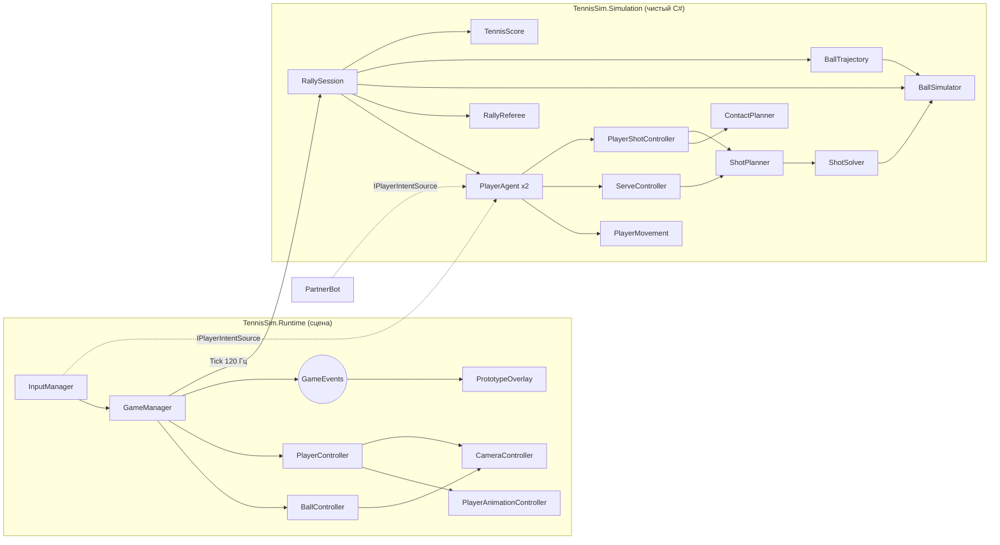
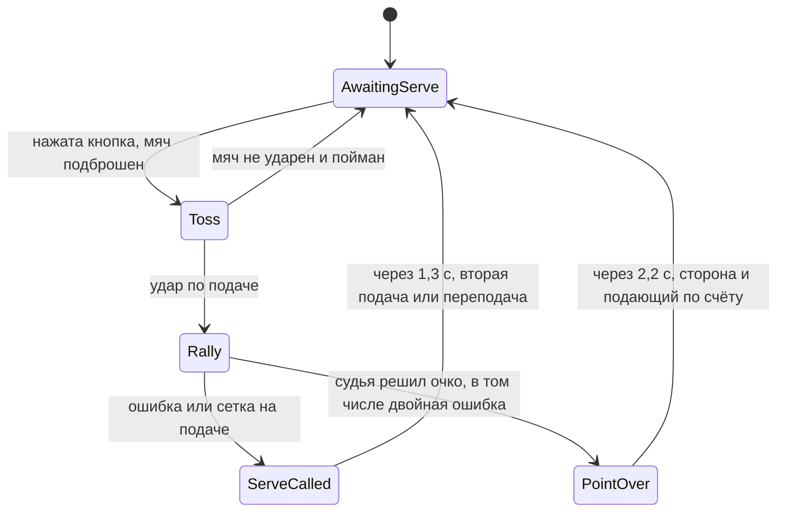
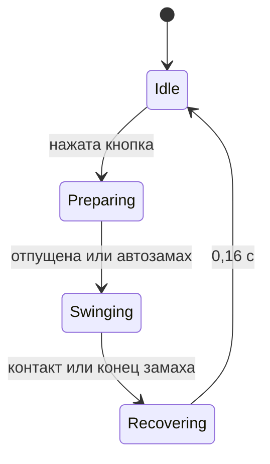

# Архитектура

## Главный принцип

Весь игровой процесс — чистый C# без сцены, в сборке `TennisSim.Simulation`. Слой MonoBehaviour только передаёт в него ввод и показывает результат.

Что это даёт:

- **Одна физика на всё.** Живой мяч, предсказание траектории и решатель ударов вызывают один и тот же `BallSimulator`. Предсказание точно до следующего удара, поэтому ИИ не понадобится отдельная модель мяча.
- **Проверка без редактора.** Целые розыгрыши прогоняются в тестах за секунды.
- **Замена визуала не трогает логику.** Модели и анимации следующего подэтапа подключаются только к слою представления.

Источник решений игрока — интерфейс `IPlayerIntentSource`. Человек, бот-партнёр и тестовый скрипт для `PlayerAgent` неотличимы, поэтому ИИ подэтапа 4 подключается как ещё одна реализация.

## Соответствие компонентам из ТЗ

| Компонент ТЗ | Где сейчас | Форма |
|---|---|---|
| GameManager | `GameManager` + `RallySession` | Хост + логика |
| CourtController | `CourtGeometry`; визуал строит `ProjectBuilder` | Статические данные: сцене нечего хранить |
| BallController | `BallController` + `BallSimulator` | Представление + физика |
| PlayerController | `PlayerController` + `PlayerAgent` | Представление + логика |
| PlayerMovement, PlayerShotController | Одноимённые классы | Чистый C# |
| PlayerAnimationController | Одноимённый класс | Единственный вход — `Present()`, внутри Animator |
| CameraController, InputManager | Одноимённые классы | MonoBehaviour |
| ServeController | Одноимённый класс + `RallySession.Toss` | Чистый C# |
| MatchManager | `TennisScore` + `RallySession` | Счёт, смена подачи и сторон подачи |
| PlayerAIController, AudioManager, UIManager | Ещё нет | Подэтапы 4–5 |

Баланс лежит в ScriptableObject: `BallPhysicsConfig`, `ShotConfig`, `PlayerConfig` (папка `Assets/TennisSim/Config`).

## Состояния

**Сессия** (`RallySession`):

**Подача** (`ServeController`) повторяет ритм удара: нажатие — подброс, отпускание — замах. `RallySession.Toss` бросает мяч так, чтобы он прошёл через точку контакта `ShotTuning.ServeContact` на спуске. Момент этого прохода берётся из предсказанной траектории. По ошибке относительно него считается качество подачи; бот по нему же отпускает кнопку.

**Судья** на подаче проверяет только квадрат (`CourtGeometry.ServiceBoxFor`). Касание троса с попаданием в квадрат — переподача. После первого отскока в квадрате розыгрыш живой. Нетронутая подача — эйс. Принимающий может готовиться к удару, пока подача летит, но `ContactPlanner` и замах допускают контакт только после отскока (`PlayerPerception.MustLetBounce`).

**Замах** (`PlayerShotController`):

## Удар от нажатия до полёта

1. **Нажатие.** `ContactPlanner` просматривает предсказанную траекторию и выбирает момент контакта: достижимый, на удобной высоте. Обычный удар предпочитает мяч после отскока, кнопка «с лёта» — как можно раньше, высокий мяч в воздухе — смэш.
2. **Подготовка.** Стик двигает игрока, а точка контакта пересчитывается под его положение. Автопозиционирование ведёт игрока в стойку, если стик отпущен или до контакта осталось только время добежать. С этого момента стик лишь целится. Длительность подготовки добавляет силу.
3. **Замах.** Ракетка приходит в точку контакта через `SwingLatency`. Контакт происходит, когда мяч реально в досягаемости. Если мяч пролетел мимо, это промах.
4. **Оценка.** `ContactEvaluator` считает балл из ошибки момента, положения относительно линии полёта мяча и скорости бега. Балл задаёт Perfect, Good или Poor.
5. **Запуск.** `ShotPlanner` определяет тип удара, точку прицела и разброс по качеству контакта. `ShotSolver` подбирает начальную скорость по реальной физике. Дальше мяч летит свободно: заранее заданных траекторий нет.

**Что ещё меняет удар, кроме кнопки** (параметры в разделе «Shot variety» у `ShotTuning`):

| Условие | Результат |
|---|---|
| Мяч далеко от точки удара (`DefensiveReach`) | Защитный удар: медленный, высоко, в середину |
| Мяч низко и ещё поднимается после отскока | Удар с полулёта |
| Ранний или поздний контакт | Мяч уводит поперёк или наружу (`MistimePull`) |
| Высокий отскок или низкий мяч | Плюс или минус к скорости |
| Плоский удар или с лёта по быстрому мячу | Часть скорости соперника возвращается |

Резаная подача закручена вокруг вертикальной оси. `ShotSolver` за несколько проходов сдвигает прицел против закрутки, так что мяч всё равно садится в цель.

## Физика мяча

Шаг фиксированный, 120 Гц.

- **В полёте:** гравитация, сопротивление воздуха, сила Магнуса (`Cl = 1 / (2 + v / rω)`), затухание вращения.
- **Отскок:** импульсная модель с кулоновским трением. Топспин ускоряет мяч после отскока, резаный тормозит. Упругость падает с ростом скорости удара о корт.
- **Сетка:** профиль высоты общий с визуальной сеткой. Удар в полотно гасит мяч на стороне бьющего, касание троса перебрасывает его замедленным.
- **Устойчивость:** столкновения проверяются вдоль всего шага, поэтому мяч не проходит сквозь корт и сетку. Это закреплено стресс-тестом на 2000 случайных ударов.

## Графика и анимация

**Конвейер в Blender** (`Tools/Blender`):

| Скрипт | Что делает |
|---|---|
| `prepare_meshes.py` | Масштаб до реальных размеров, упрощение со сканов на 1,5 млн треугольников (игрок 30 тыс., ракетка 3 тыс., мяч 800), запекание деталей в карту нормалей, отделение мяча от ракетки, замена струн текстурой, второй комплект формы |
| `rig_and_animate.py` | Скелет, веса вершин и все клипы, экспорт в FBX |
| `make_court_textures.py` | Шум из шейдеров Blender, разметка по официальным размерам, потёртости в зонах движения, детальные карты зернистости. Зелёный хард с терракотовой зоной вокруг |
| `make_stadium.py` | Чаша трибун, кресла, проходы, рекламные борта с выдуманными брендами, вышка судьи, стулья игроков, табло. Пишет `Stadium.fbx` (по мешу на материал) и `Stadium_Layout.json` (кресла и экран табло) |
| `make_crowd_atlas.py` | Рендер модели игрока в позах зрителя, спереди и сзади, плюс маска одежды для перекраски |

**Анимации считаются, а не рисуются вручную.** Поза задаётся положением стоп и ручки ракетки относительно игрока, а обратная кинематика решает конечности на каждом кадре. Отсюда два свойства:

- Контактная поза удара стоит в той же точке, что `StrikeZone` в логике.
- Опорная стопа в циклах бега движется ровно со скоростью игрока из `PlayerMovementTuning`, поэтому не скользит. Если меняете скорости в конфиге, пересоберите клипы.

**Animator** (`Generated/Player.controller`, создаётся в `ProjectBuilder`):

- Базовый слой: 2D blend tree по скорости в метрах в секунду (`MoveX`, `MoveZ`), а также `Idle`, `Celebrate`, `PointLost`. Сюда же подача всем телом: `Serve_Ready` (мяч в руке), `Serve_Toss`, `Serve_Swing`. Между состояниями подачи переключает код, переходов в контроллере у них нет.
- Слой `UpperBody` с маской от позвоночника и выше: подготовка и замах. Поэтому бить можно на бегу. Резаный и укороченный, а также недостижимый мяч, играются клипами `ForehandSlice`/`BackhandSlice` сверху вниз.
- Параметр `SwingSpeed` подбирает скорость клипа замаха так, чтобы контактная поза совпала с прилётом мяча.

**Известное ограничение.** Контактная поза одна, примерно на высоте пояса. На мячах намного выше или ниже ракетка заметно расходится с мячом. Логику это не затрагивает, но для точного совпадения нужна коррекция руки во время игры.

Чтобы заменить модель, нужен FBX с теми же именами клипов; игровой код менять не придётся.

## Стадион

**Чаша.** Ряды — это кольца вокруг корта, поэтому трибуны в углах смыкаются без швов. Сколько рядов, решает сторона:

| Сторона | Рядов | Почему |
|---|---|---|
| Боковые | 20 | Основная вместимость |
| Дальняя | 14 | Табло над ней должно попадать в кадр игровой камеры |
| Ближняя | 9 | Камера смотрит поверх неё и не должна оказаться внутри зрителей |

**Зрители** (`Crowd.shader`, `CrowdController`):

- Это карточки, по четыре вершины на кресле. Вершинный шейдер разворачивает карточку к камере и выбирает кадр атласа: вид спереди или сзади, поза по общему уровню возбуждения.
- У каждого зрителя свои случайные числа в UV1. Они задают, кто сидит прямо, а кто наклонился, цвет футболки и шорт через маску, фазу хлопков и то, насколько легко зритель встаёт.
- Весь стадион рисуется одним мешем `Generated/Crowd.mesh.asset` и одним вызовом.
- `CrowdController` слушает `GameEvents`. Во время подачи и розыгрыша зрители тихие. После очка хлопают, после долгого розыгрыша, эйса или гейма встают.

**Табло** (`Scoreboard`) — `TextMesh` на экране, позиция экрана берётся из `Stadium_Layout.json`. Показывает сеты, геймы, очки, кто подаёт и скорость последней подачи.

## Решения, уточняющие ТЗ

- **Клавиши U и H.** В ТЗ есть резаный и плоский удары, но нет клавиш для них. Добавлены U и H рядом с остальными.
- **Смэш и удар с лёта определяются контактом.** Кнопка задаёт намерение, а тип зависит от мяча: удар в воздухе становится ударом с лёта, высокий мяч — смэшем.
- **Бот-партнёр.** Не из ТЗ: без него один человек не проверит розыгрыш. Это не ИИ подэтапа 4, у него нет уровней сложности.
- **Выбор подачи кнопкой.** Плоская — H/X, резаная — U/B, остальные кнопки — кик, самая надёжная.
- **Подача раньше подэтапа 5.** Подача и счёт сделаны по просьбе вместе с доработкой механик. HUD и звук остаются на подэтап 5.

## Порядок подэтапов

1. Базовая механика: сделано, дорабатывается.
2. Модели, ракетки, анимации: сделано, см. «Графика и анимация».
3. Стадион: выставочный корт, день — готово. Дальше: вечер с прожекторами, другие покрытия и арены.
4. ИИ: новые реализации `IPlayerIntentSource` и конфиг сложности.
5. Подача и счёт готовы; тай-брейк, смена сторон, HUD, звук — подписчики `GameEvents`.
