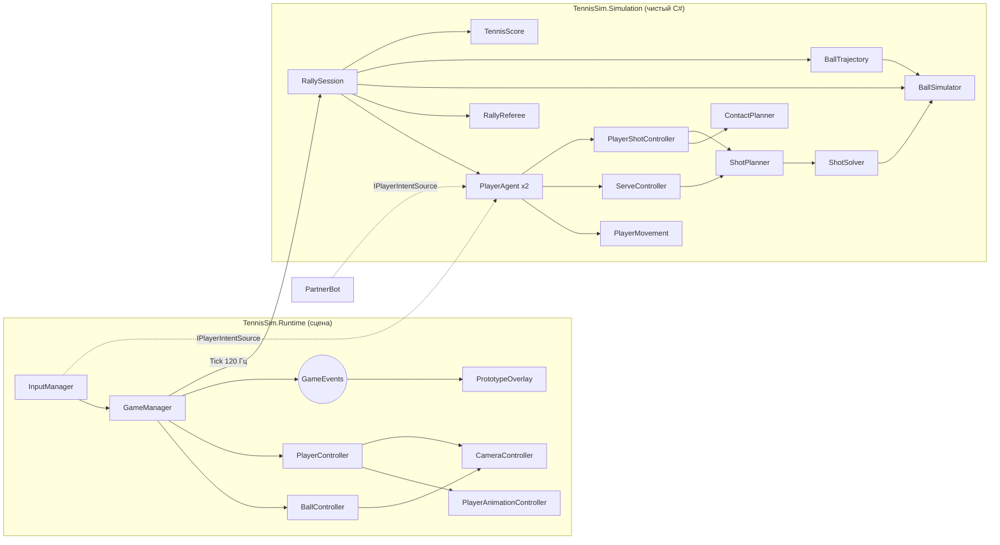
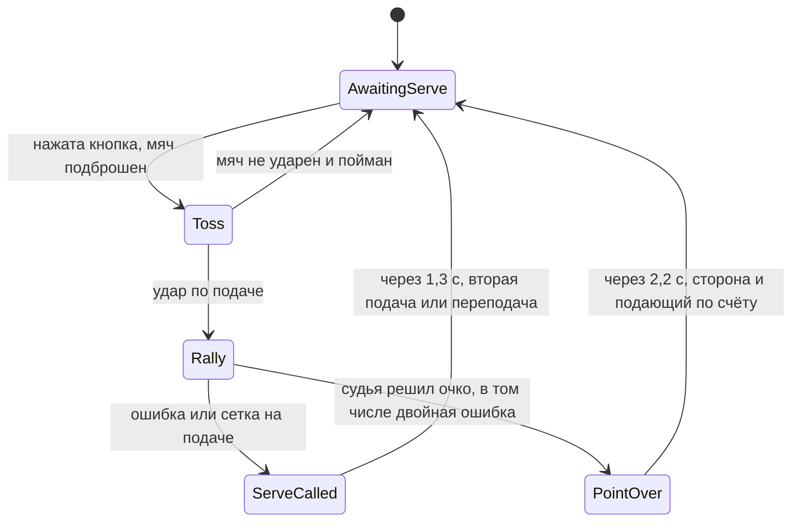
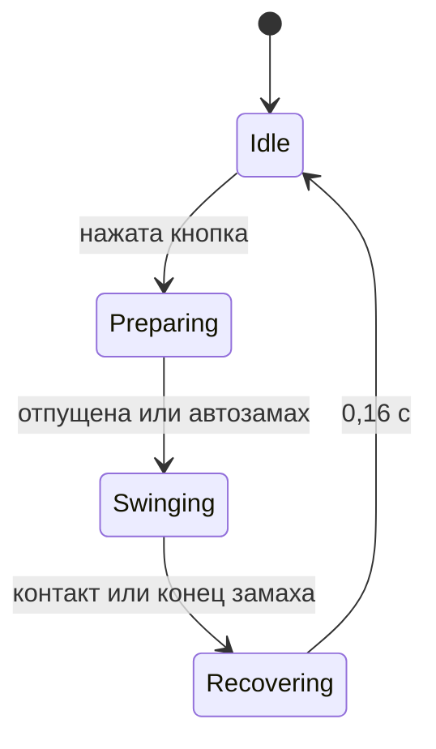

# Архитектура

## Главный принцип

Весь игровой процесс — чистый C# без сцены, в сборке `TennisSim.Simulation`. Слой MonoBehaviour только передаёт в него ввод и показывает результат.

Что это даёт:

- **Одна физика на всё.** Живой мяч, предсказание траектории и решатель ударов вызывают один и тот же `BallSimulator`. Предсказание точно до следующего удара, поэтому ИИ не понадобится отдельная модель мяча.
- **Проверка без редактора.** Целые розыгрыши прогоняются в тестах за секунды.
- **Замена визуала не трогает логику.** Модели и анимации следующего подэтапа подключаются только к слою представления.

Источник решений игрока — интерфейс `IPlayerIntentSource`. Для `PlayerAgent` человек, ИИ-соперник, бот-партнёр и тестовый скрипт неотличимы.

## ИИ-соперник

`OpponentAI` играет только через намерения, как человек с геймпадом: двигает стик, целится правым стиком, нажимает и отпускает кнопки. Ему доступно то же, что видно на экране: мяч, его траектория и положение соперника.

- **Без мяча** встаёт на середину возможных ответов соперника: за задней линией, сдвигаясь в сторону, куда ушёл мяч. После атакующего удара может выйти к сетке. Свеча над ним возвращает его назад.
- **С мячом** выбирает удар по ситуации:

| Ситуация | Удар |
|---|---|
| Высокий мяч в воздухе | Смэш в открытый корт |
| Не успевает | Защитный резаный или свеча |
| Соперник у сетки | Свеча или обводящий |
| Сам у сетки | Удар с лёта под углом |
| Соперник далеко за линией | Укороченный |
| Короткий или высокий мяч | Атака плоским, иногда с выходом к сетке |
| Обычный розыгрыш | Топспин кросс или в открытый корт, иногда резаный |

  Чем дольше розыгрыш, тем чаще ИИ идёт на активный удар («нетерпение»).
- **Подача:** на первой рискует (плоская или резаная), на второй страхуется киком. Направление выбирает между T, корпусом и шириной.
- **Уровни** (`AiTuning.For`) различаются только человеческими ограничениями: временем реакции, разбросом тайминга, долей просто зажатых ударов, смелостью прицела, ошибками в оценке аута, агрессией и выходами к сетке.

`Tests/EditMode/AiTests` играют целые матчи. Сильный ИИ должен уверенно обыгрывать лёгкого, бить от соперника, держать центр, выходить к сетке и подавать в основном в квадрат.

## Поток игры

`GameManager` хранит фазу: меню, матч, пауза, итоги.

- В меню за панелью идёт показательный матч двух ИИ, поэтому стадион живой.
- «Играть» создаёт новую `RallySession` с выбранными `MatchRules` и заново привязывает к ней мяч и игроков, сцену не перезагружая.
- Пауза — это `Time.timeScale = 0`.
- `HudController` строит интерфейс кодом на UGUI: меню, панель счёта, крупные надписи (эйс, ошибка, ровно, гейм), оценку удара человека, подсказку на подаче, паузу и итоги. С клавиатурой и геймпадом работает через `InputSystemUIInputModule`.

## Настройки

`GameSettings` хранит настройки в PlayerPrefs; экраны настроек открываются из меню и паузы (`HudController.Settings.cs`).

- **Графика:** три уровня. Меняются дальность и разрешение теней, число каскадов, MSAA и масштаб рендера. Пресет применяется к копии ассета URP и только в собранной игре: в редакторе подмена записалась бы в настройки проекта.
- **Звук:** громкость игры и трибун отдельно.
- **Экран:** полный экран или окно.
- **Управление:** переназначение ударов и ускорения для клавиатуры и геймпада через `PerformInteractiveRebinding`. Переназначения сохраняются как JSON Input System и применяются к копиям действий обоих игроков, сброс возвращает стандартные.

## Звук

`AudioManager` слушает `GameEvents`. Клипы синтезирует `Tools/Audio/make_sounds.py`.

- Звук удара зависит от вида удара и качества контакта: чистый, резаный, в обод.
- Громкость отскока зависит от скорости удара о корт.
- Кроссовки скрипят на резкой смене направления.
- Гул трибун затихает на подачу и розыгрыш. После очка звучат аплодисменты, после эйса, длинного розыгрыша или гейма — ликование, на ошибку подачи — вздох.

После выигранного гейма, сета или матча `CameraController` на пару секунд показывает победителя крупным планом.

## Соответствие компонентам из ТЗ

| Компонент ТЗ | Где сейчас | Форма |
|---|---|---|
| GameManager | `GameManager` + `RallySession` | Хост + логика |
| CourtController | `CourtGeometry`; визуал строит `ProjectBuilder` | Статические данные: сцене нечего хранить |
| BallController | `BallController` + `BallSimulator` | Представление + физика |
| PlayerController | `PlayerController` + `PlayerAgent` | Представление + логика |
| PlayerMovement, PlayerShotController | Одноимённые классы | Чистый C# |
| PlayerAnimationController | Одноимённый класс | Единственный вход — `Present()`, внутри Animator |
| CameraController, InputManager | Одноимённые классы | MonoBehaviour |
| ServeController | Одноимённый класс + `RallySession.Toss` | Чистый C# |
| MatchManager | `TennisScore` + `RallySession` + `GameManager` | Счёт, тай-брейк, конец матча, поток игры |
| PlayerAIController | `OpponentAI` | Ещё одна реализация `IPlayerIntentSource` |
| AudioManager | Одноимённый класс | Подписчик `GameEvents` |
| UIManager | `HudController` | UGUI, строится в коде |

Баланс лежит в ScriptableObject: `BallPhysicsConfig`, `ShotConfig`, `PlayerConfig` (папка `Assets/TennisSim/Config`).

## Состояния

**Сессия** (`RallySession`):

**Подача** (`ServeController`) повторяет ритм удара: нажатие — подброс, отпускание — замах. `RallySession.Toss` бросает мяч так, чтобы он прошёл через точку контакта `ShotTuning.ServeContact` на спуске. Момент этого прохода берётся из предсказанной траектории. По ошибке относительно него считается качество подачи; бот по нему же отпускает кнопку.

**Судья** на подаче проверяет только квадрат (`CourtGeometry.ServiceBoxFor`). Касание троса с попаданием в квадрат — переподача. После первого отскока в квадрате розыгрыш живой. Нетронутая подача — эйс. Принимающий может готовиться к удару, пока подача летит, но `ContactPlanner` и замах допускают контакт только после отскока (`PlayerPerception.MustLetBounce`).

**Замах** (`PlayerShotController`):

## Удар от нажатия до полёта

1. **Нажатие.** `ContactPlanner` просматривает предсказанную траекторию и выбирает момент контакта: достижимый, на удобной высоте. Обычный удар предпочитает мяч после отскока, кнопка «с лёта» — как можно раньше, высокий мяч в воздухе — смэш.
2. **Подготовка.** Стик двигает игрока, а точка контакта пересчитывается под его положение. Автопозиционирование ведёт игрока в стойку, если стик отпущен или до контакта осталось только время добежать. С этого момента стик лишь целится. Длительность подготовки добавляет силу.
3. **Замах.** Ракетка приходит в точку контакта через `SwingLatency`. Контакт происходит, когда мяч реально в досягаемости. Если мяч пролетел мимо, это промах.
4. **Оценка.** `ContactEvaluator` считает балл из ошибки момента, положения относительно линии полёта мяча и скорости бега. Балл задаёт Perfect, Good или Poor.
5. **Запуск.** `ShotPlanner` определяет тип удара, точку прицела и разброс по качеству контакта. `ShotSolver` подбирает начальную скорость по реальной физике. Дальше мяч летит свободно: заранее заданных траекторий нет.

**Что ещё меняет удар, кроме кнопки** (параметры в разделе «Shot variety» у `ShotTuning`):

| Условие | Результат |
|---|---|
| Мяч далеко от точки удара (`DefensiveReach`) | Защитный удар: медленный, высоко, в середину |
| Мяч низко и ещё поднимается после отскока | Удар с полулёта |
| Ранний или поздний контакт | Мяч уводит поперёк или наружу (`MistimePull`) |
| Высокий отскок или низкий мяч | Плюс или минус к скорости |
| Плоский удар или с лёта по быстрому мячу | Часть скорости соперника возвращается |

Резаная подача закручена вокруг вертикальной оси. `ShotSolver` за несколько проходов сдвигает прицел против закрутки, так что мяч всё равно садится в цель.

## Физика мяча

Шаг фиксированный, 120 Гц.

- **В полёте:** гравитация, сопротивление воздуха, сила Магнуса (`Cl = 1 / (2 + v / rω)`), затухание вращения.
- **Отскок:** импульсная модель с кулоновским трением. Топспин ускоряет мяч после отскока, резаный тормозит. Упругость падает с ростом скорости удара о корт.
- **Сетка:** профиль высоты общий с визуальной сеткой. Удар в полотно гасит мяч на стороне бьющего, касание троса перебрасывает его замедленным.
- **Устойчивость:** столкновения проверяются вдоль всего шага, поэтому мяч не проходит сквозь корт и сетку. Это закреплено стресс-тестом на 2000 случайных ударов.

## Графика и анимация

**Конвейер в Blender** (`Tools/Blender`):

| Скрипт | Что делает |
|---|---|
| `prepare_meshes.py` | Масштаб до реальных размеров, упрощение со сканов на 1,5 млн треугольников (игрок 30 тыс., ракетка 3 тыс., мяч 800), запекание деталей в карту нормалей, отделение мяча от ракетки, замена струн текстурой, второй комплект формы |
| `rig_and_animate.py` | Скелет, веса вершин и все клипы, экспорт в FBX |
| `make_court_textures.py` | Шум из шейдеров Blender, разметка по официальным размерам, потёртости в зонах движения, детальные карты зернистости. Зелёный хард с терракотовой зоной вокруг |
| `make_stadium.py` | Чаша трибун, кресла, проходы, рекламные борта с выдуманными брендами, вышка судьи, стулья игроков, табло. Пишет `Stadium.fbx` (по мешу на материал) и `Stadium_Layout.json` (кресла и экран табло) |
| `make_crowd_atlas.py` | Рендер модели игрока в позах зрителя, спереди и сзади, плюс маска одежды для перекраски |

**Анимации считаются, а не рисуются вручную.** Поза задаётся положением стоп и ручки ракетки относительно игрока, а обратная кинематика решает конечности на каждом кадре. Отсюда два свойства:

- Контактная поза удара стоит в той же точке, что `StrikeZone` в логике.
- Опорная стопа в циклах бега движется ровно со скоростью игрока из `PlayerMovementTuning`, поэтому не скользит. Если меняете скорости в конфиге, пересоберите клипы.
- Нога модели короткая: от тазобедренного сустава до щиколотки 0,58 м. Длина опоры в `GAITS` подобрана так, чтобы нога доставала до стопы. Таз опускается ровно настолько, насколько опорной ноге нужно дотянуться (`reach_limited_hips`). Поэтому при ходьбе таз выше всего над опорной ногой и проседает при переносе веса, как у человека. Если удлинить шаг так, что стопа окажется дальше длины ноги по горизонтали, скрипт остановится с ошибкой, а не растянет ногу.

**Animator** (`Generated/Player.controller`, создаётся в `ProjectBuilder`):

- Базовый слой: 2D blend tree по скорости в метрах в секунду (`MoveX`, `MoveZ`), а также `Idle`, `Celebrate`, `PointLost`, `SplitStep`. Сюда же подача всем телом: `Serve_Ready` (мяч в руке), `Serve_Toss`, `Serve_Swing`. Между состояниями подачи переключает код, переходов в контроллере у них нет.
- Слой `UpperBody` с маской от позвоночника и выше: подготовка и замах. Поэтому бить можно на бегу. Резаный и укороченный, а также недостижимый мяч, играются клипами `ForehandSlice`/`BackhandSlice` сверху вниз.
- Параметр `SwingSpeed` подбирает скорость клипа замаха так, чтобы контактная поза совпала с прилётом мяча.

**Замах привязан к контакту.** Контактная поза клипа должна быть на экране ровно в момент удара.

- Видимый замах начинается за время контакта клипа (0,14 с) до ожидаемого удара, даже если кнопка ещё зажата: удержание всё равно ударит само чуть позже.
- Каждый кадр `PlayerAnimationController` читает фактическое время клипа в аниматоре и ставит скорость так, чтобы к следующему кадру клип был там, где нужно.
- После удара клип доигрывается в своём темпе.

**Подгонка позы после аниматора** (`PlayerIkRig`, мировые координаты, поэтому не зависит от осей костей):

- *Ракетка к мячу.* Вес плавно растёт к моменту контакта и спадает после. Сначала корпус наклоняется к мячу, если одной руке не хватает, затем двухзвенная IK ведёт кисть, угол ракетки берётся из клипа. На вытянутой руке кисть доворачивает головку. Центр струн берётся из bind pose меша струн.
- *Низкий мяч.* Таз опускается, а ноги решаются IK обратно к стопам из клипа: игрок приседает, стопы не съезжают.
- *Взгляд.* Голова и шея поворачиваются к мячу, у поворота вбок и кивка свои пределы.
- *Стопы.* Когда игрок стоит или почти стоит, стопы прилипают к корту. Если корпус повернулся или сместился, стопа переставляется коротким шагом, по одной за раз. Поэтому на развороте ноги переступают, а не скользят. Перед ударом с места передняя нога шагает к мячу, на форхенде левая, на бэкхенде правая. Вес переносится на неё до конца проводки. На бегу фиксация мягко отпускается, и ноги ведёт клип.

Тест `AnimationCaptureTests` снимает удары сбоку раскадровками (`Logs/Screenshots/anim_*.png`) и проверяет, что центр струн в среднем проходит в пределах 0,18 м от мяча.

**Между ударами и очками:**

- *Сплит-степ.* Когда соперник бьёт, стоящий игрок делает маленький подскок с приземлением в широкую стойку.
- *Переход к следующему очку.* Игроки не телепортируются: после реакции на очко они идут на места, лицом по ходу движения. Подача начинается, когда оба на месте, но не позже 6 с.

Чтобы заменить модель, нужен FBX с теми же именами клипов; игровой код менять не придётся.

## Стадион

**Чаша.** Ряды — это кольца вокруг корта, поэтому трибуны в углах смыкаются без швов. Сколько рядов, решает сторона:

| Сторона | Рядов | Почему |
|---|---|---|
| Боковые | 20 | Основная вместимость |
| Дальняя | 14 | Табло над ней должно попадать в кадр игровой камеры |
| Ближняя | 9 | Камера смотрит поверх неё и не должна оказаться внутри зрителей |

**Зрители** (`Crowd.shader`, `CrowdController`):

- Это карточки, по четыре вершины на кресле. Вершинный шейдер разворачивает карточку к камере и выбирает кадр атласа: вид спереди или сзади, поза по общему уровню возбуждения.
- У каждого зрителя свои случайные числа в UV1. Они задают, кто сидит прямо, а кто наклонился, цвет футболки и шорт через маску, фазу хлопков и то, насколько легко зритель встаёт.
- Весь стадион рисуется одним мешем `Generated/Crowd.mesh.asset` и одним вызовом.
- `CrowdController` слушает `GameEvents`. Во время подачи и розыгрыша зрители тихие. После очка хлопают, после долгого розыгрыша, эйса или гейма встают.

**Табло** (`Scoreboard`) — `TextMesh` на экране, позиция экрана берётся из `Stadium_Layout.json`. Показывает сеты, геймы, очки, кто подаёт и скорость последней подачи.

**Углы** закрывают башни: там, где высокие боковые трибуны встречаются с более низкими торцевыми. На каждой башне стоит мачта с прожекторами. Их положение лежит в `Stadium_Layout.json`, и `ProjectBuilder` ставит туда точечные источники, направленные в центр корта.

**День и вечер** (`EnvironmentController`, выбор в меню):

- Вечером солнце низкое, оранжевое и тусклое, процедурное небо само уходит в закат.
- Рассеянный свет темнее, включаются прожекторы, лампы на мачтах светятся.
- Небо и лампы меняются на копиях материалов, поэтому игра в редакторе не портит ассеты.
- Прожекторы без теней: дорого, а на корте хватает тени от солнца. Зрителей прожекторы не освещают, их видимость держит рассеянный свет.

## Решения, уточняющие ТЗ

- **Клавиши U и H.** В ТЗ есть резаный и плоский удары, но нет клавиш для них. Добавлены U и H рядом с остальными.
- **Смэш и удар с лёта определяются контактом.** Кнопка задаёт намерение, а тип зависит от мяча: удар в воздухе становится ударом с лёта, высокий мяч — смэшем.
- **Бот-партнёр.** `PartnerBot` — простой бот без тактики, оставлен для тестов механики. Соперник в игре — `OpponentAI`.
- **Выбор подачи кнопкой.** Плоская — H/X, резаная — U/B, остальные кнопки — кик, самая надёжная.
- **Подача раньше подэтапа 5.** Подача и счёт сделаны по просьбе вместе с доработкой механик.

## Порядок подэтапов

1. Базовая механика: сделано, дорабатывается.
2. Модели, ракетки, анимации: сделано, см. «Графика и анимация».
3. Стадион: выставочный корт, день и вечер — готово. Дальше: другие покрытия и арены.
4. ИИ: готово, три уровня.
5. Подача, счёт с тай-брейком, меню, HUD, звук: готово. Смены сторон нет намеренно: человек всегда на ближней половине.
